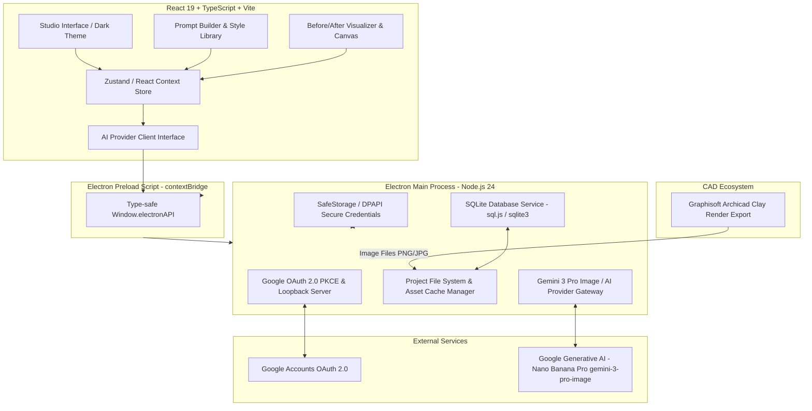

# INTERIOR AI STUDIO — Архитектура системы (TECHNICAL_ARCHITECTURE.md)

## 1. Обоснование выбора стека технологий

В техническом задании предпочтительным стеком указан Tauri 2 + Rust либо альтернативный вариант при наличии объективных технико-эксплуатационных причин (п. 3 и п. 20 ТЗ).

### Анализ окружения хоста Windows:
- В системе установлен **Node.js v24.20.0** и **npm v11.19.0**.
- Компиляторы `rustc`, `cargo` и среда сборки Microsoft Visual C++ Build Tools (MSVC v143, Windows SDK) **отсутствуют**.
- Попытка развертывания компилятора Rust и многогигабайтных библиотек MSVC в пользовательском каталоге сопряжена с рисками конфликтов привилегий Windows и нестабильностью среды сборки.
- **Решение**: Выбран стек **Electron + Vite + React 19 + TypeScript + Tailwind CSS / Studio Theme + SQLite**.
  - Гарантирует немедленную работоспособность и компиляцию без внешних C++ тулчейнов.
  - Предоставляет нативные возможности Windows через Windows DPAPI (`electron.safeStorage`) для шифрования токенов и ключей API.
  - Позволяет поднять встроенный HTTP loopback сервер для легального Google OAuth 2.0 PKCE.
  - Предоставляет прямой доступ к локальной файловой системе и быстрому хранению изображений рендеров.
  - Архитектура фронтенда (React, TypeScript, компонентный слой, стили, AI Provider Layer) на 100% модульна и независима от десктопного раннера.

---

## 2. Общая архитектурная схема (Mermaid)



---

## 3. Слой абстракции AI-провайдеров (AI Provider Layer)

Для обеспечения расширяемости в соответствии с п. 3, 5 и 15 ТЗ создается интерфейс:

```typescript
export interface GenerateImageOptions {
  prompt: string;
  negativePrompt?: string;
  sourceImageBase64: string;
  sourceImageMimeType: string;
  aspectRatio?: '1:1' | '4:3' | '16:9' | '9:16' | '3:2' | '2:3';
  geometryPreservationMode: 'strict' | 'balanced' | 'creative';
  temperature?: number;
  // Multi-turn context for iterative edits
  parentGenerationId?: string;
  history?: Array<{ role: 'user' | 'model'; text?: string; imageBase64?: string }>;
}

export interface GenerationResult {
  id: string;
  imageBase64: string;
  mimeType: string;
  width: number;
  height: number;
  model: string;
  provider: string;
  promptUsed: string;
  finishReason?: string;
  latencyMs: number;
  timestamp: number;
}

export interface IAIProvider {
  readonly id: string;
  readonly name: string;
  readonly supportedModels: string[];
  
  initialize(credentials: Record<string, string>): Promise<void>;
  testConnection(): Promise<{ success: boolean; message: string; latencyMs?: number }>;
  generateImage(options: GenerateImageOptions): Promise<GenerationResult>;
  refineImage(previousResult: GenerationResult, instruction: string): Promise<GenerationResult>;
}
```

### Реализация `GeminiProvider`:
- Модель по умолчанию: `gemini-3-pro-image` (Nano Banana Pro).
- URL вызова: `https://generativelanguage.googleapis.com/v1beta/models/gemini-3-pro-image:generateContent?key={API_KEY}`
- Тело запроса:
  ```json
  {
    "contents": [
      {
        "role": "user",
        "parts": [
          { "text": "{PROMPT}" },
          {
            "inlineData": {
              "mimeType": "image/png",
              "data": "{BASE64_CLAY_RENDER}"
            }
          }
        ]
      }
    ],
    "generationConfig": {
      "responseModalities": ["TEXT", "IMAGE"]
    }
  }
  ```
- Для повторных уточнений (редактирования) отправляется диалоговый массив `contents` с сохранением предыдущего сгенерированного рендера и новой пользовательской инструкцией.

---

## 4. Схема базы данных SQLite

Хранилище организуется локально: `%APPDATA%/InteriorAIStudio/database.sqlite`.
Файлы изображений хранятся в каталоге `%APPDATA%/InteriorAIStudio/projects/{project_id}/assets/`.

### Таблицы:
```sql
CREATE TABLE IF NOT EXISTS projects (
  id TEXT PRIMARY KEY,
  name TEXT NOT NULL,
  description TEXT,
  room_type TEXT NOT NULL DEFAULT 'living_room',
  created_at INTEGER NOT NULL,
  updated_at INTEGER NOT NULL,
  thumbnail_path TEXT
);

CREATE TABLE IF NOT EXISTS generations (
  id TEXT PRIMARY KEY,
  project_id TEXT NOT NULL,
  parent_id TEXT,
  source_image_path TEXT NOT NULL,
  output_image_path TEXT NOT NULL,
  prompt TEXT NOT NULL,
  style_id TEXT NOT NULL,
  room_type TEXT NOT NULL,
  geometry_mode TEXT NOT NULL,
  lighting TEXT,
  materials TEXT,
  atmosphere TEXT,
  provider TEXT NOT NULL DEFAULT 'gemini',
  model TEXT NOT NULL DEFAULT 'gemini-3-pro-image',
  width INTEGER,
  height INTEGER,
  latency_ms INTEGER,
  created_at INTEGER NOT NULL,
  FOREIGN KEY(project_id) REFERENCES projects(id) ON DELETE CASCADE
);

CREATE TABLE IF NOT EXISTS custom_styles (
  id TEXT PRIMARY KEY,
  name TEXT NOT NULL,
  description TEXT,
  prompt_modifiers TEXT NOT NULL,
  created_at INTEGER NOT NULL
);

CREATE TABLE IF NOT EXISTS settings (
  key TEXT PRIMARY KEY,
  value TEXT NOT NULL
);
```

---

## 5. Безопасность и хранение учетных данных (AppSec)

1. **Google OAuth 2.0 PKCE**:
   - Генерация криптографически стойкого `code_verifier` и `code_challenge` (SHA-256).
   - Поднятие эфемерного локального сервера на `127.0.0.1` для приема кода перенаправления.
   - Никаких перехватов сессий браузера или чтения cookies.
2. **Шифрование чувствительных данных**:
   - API-ключи Gemini и токены OAuth шифруются средствами Windows Data Protection API (через `safeStorage.encryptString()` / `safeStorage.decryptString()`).
   - Ключи не хранятся в открытом тексте ни в БД, ни в файлах конфигурации, ни в логах.
3. **Изоляция контекста Electron (Context Isolation)**:
   - В окне рендерера отключен `nodeIntegration`, включен `contextIsolation`.
   - Обмен данными происходит только через типизированный мост `contextBridge` с валидацией входных аргументов.
4. **Конфиденциальность пользовательских данных**:
   - Локальные проекты работают в 100% автономном режиме.
   - Изображения отправляются исключительно в Google Generative AI API при нажатии кнопки генерации.
